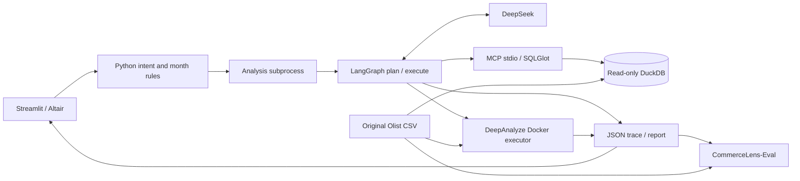

# CommerceLens

An auditable e-commerce analysis Agent with controlled execution and independent evaluation.

CommerceLens answers supported Chinese business questions over the public Olist dataset. It decomposes merchandise-value changes, investigates declining categories and sellers, and connects each report to executed SQL and review evidence.

中文简介：支持中文经营问数、贡献拆解与受控下钻，保留查询证据，提供独立评测和离线演示。

## Quick start — offline replay

Windows with Python 3.11 is the supported replay environment. A fresh Python 3.11.9 virtual environment was created for this revision and requirements-replay.txt was installed from official PyPI. This path uses shipped historical traces and requires no API key, Docker or raw dataset.

```powershell
py -3.11 -m venv .venv
.venv/Scripts/python.exe -m pip install -r requirements-replay.txt
powershell -NoProfile -ExecutionPolicy Bypass -File scripts/start_demo.ps1
```

Open [localhost](http://127.0.0.1:8501/), click **查看离线演示**, and select case A. Read **经营摘要**, then expand **执行证据** and **评测**. Switching to case C shows an increase despite fewer orders.

## Fresh-environment replay verification

Fresh replay validation passed on Windows 10, Python 3.11.9, Streamlit 1.67.0. A newly created environment installed requirements-replay.txt from official PyPI. All three cases, SQL evidence and evaluation widgets passed Streamlit AppTest. A real Streamlit process returned health ok and homepage HTTP 200. No DeepSeek, Docker or raw data was used.

The exact resolved package set and checks are recorded in [fresh replay validation](docs/fresh_replay_validation.json). Browser screenshots remain pending.

## Engineering highlights

- Controlled analysis orchestration combines model task selection with Python diagnostic rules and LangGraph state.
- E-commerce adaptation defines Olist-specific metric grains, monthly comparisons and category/seller drill-down.
- Independent evaluation checks both numeric results and executed task paths, supported by CSV Oracle and query-linked review evidence.

## Key features and core workflow

The supported question families are two-month merchandise comparisons, all-time overview metrics and top merchandise categories. Example input is **2017年12月比11月，销售额变化了多少？**

The historical case A reports a BRL 266,357.20 decline, with BRL 247,953.91 attributable to the order-volume component. The workflow then queries declining categories and sellers. The page presents business summaries and contribution charts with expandable SQL, query IDs and Docker review records.

## Architecture and technology stack



## Agent orchestration

Normal mode lets the model choose among eligible registered tasks and eventually finish. Diagnostic mode restricts every planning round to at most one candidate. Python determines decline/growth, contribution-based branches, the leading category and termination. LangGraph maintains execution state and dependencies.

SQL comes from validated templates or saved query definitions. Diagnostic reports always use Python rendering after checking model-returned fact fields. CSV aggregation has an independent implementation; contribution decomposition shares the same function inside and outside Docker.

## Harness-style execution governance

The execution boundary validates task IDs, dependencies, bounded retries, SQL AST nodes and result structures. DuckDB is read-only with external access disabled, two threads, a 512MB memory setting and a query-interrupt timer. The Docker reviewer uses trusted project code, explicitly disables networking and retains query-linked review results.

This is single-Agent orchestration. The page reuses the DeepAnalyze executor modules listed in [third-party notices](THIRD_PARTY_NOTICES.md).

## Live configuration and data preparation

Install the full pinned dependencies and obtain the nine CSVs following [data preparation](data/README.md).

```powershell
.venv/Scripts/python.exe -m pip install -r requirements-demo.txt
.venv/Scripts/python.exe scripts/build_phase1_data.py
Copy-Item .env.example .env
docker pull python:3.11-slim
```

Fill in the existing configuration keys in .env before starting live analysis.

| Key | Purpose |
|---|---|
| LLM_BASE_URL | https://api.deepseek.com or its /v1 path |
| LLM_MODEL_ID | Model available to your DeepSeek account |
| LLM_API_KEY | Your private API key |

COMMERCE_LLM_CONFIG can point to another configuration file. Live requests send standardized tasks and public aggregates to the configured DeepSeek endpoint and may incur API costs. Docker Desktop must be running Linux containers. The candidate includes the required pinned DeepAnalyze execution modules at their original relative paths.

This revision installs only the offline replay requirements under owner authorization. Live API execution, full live-dependency installation and Docker image pulling were not performed. Live reproduction commands remain opt-in.

## Evaluation framework and historical results

| Suite | Historical saved result | Meaning |
|---|---:|---|
| Golden SQL | 10/10 | SQL rows match independently aggregated CSV expectations |
| Agent | 5/5 | Expected task path, numeric result and query-ID presence |
| Docker Agent | 5/5 | Same checks plus matched Docker evidence |
| SQL policy | 5/5 | Five forbidden requests rejected and DB hash unchanged |
| Fault/report checks | 11/11 | Injected timeout, invalid-plan, empty-data and field-validation checks |

The initial Agent suite scored 4/5. Overview executed three queries instead of the expected one. A later saved run follows the one-query path and scores 5/5. This is a small fixed-suite regression result.

See [evaluation details and commands](docs/evaluation.md) and [this candidate's audit](GITHUB_RELEASE_AUDIT.md) for current validation results. Replay measures rescoring time, not original model latency.

## Demo screenshots

Current release screenshots are pending capture. No generated mockup or old screenshot is presented as this candidate's runtime evidence. The actual replay can be inspected locally through the quick start.

## Project structure

The code retains scripts/ and commercelens_eval/ to preserve import and execution paths. See [complete candidate tree](docs/project_structure.md), [technical design](docs/technical_design.md), [architecture](docs/architecture.md), and [function-level map](docs/implementation_map.md).

## Known limitations and roadmap

Chinese intent routing covers limited regex patterns. Diagnostic task branching and summaries use deterministic rules. Citations are checked through ID presence, with no sentence-level semantic judge. OpenJudge and a Grader Adapter are absent. Data are historical snapshots. Incremental ingestion, queues, authentication, concurrency validation and cross-dataset generalization remain future work.

Human BI time savings have not been measured. SQL baselines are given their task paths in advance, while Agent timing includes model and Docker work.

## License and acknowledgements

CommerceLens-owned source and documentation are MIT under [LICENSE](LICENSE), with the owner-confirmed public attribution Yessyye (https://github.com/Yessyye/). Copied vendor files retain their own upstream licenses. Olist-derived fixtures and reports are governed separately in [DATA_LICENSE.md](DATA_LICENSE.md). Raw CSVs are excluded. Pinned upstream code retains its MIT notice.

Credits and dependencies are recorded in [THIRD_PARTY_NOTICES.md](THIRD_PARTY_NOTICES.md).

The per-file artifact disclosure is in [derived data inventory](docs/derived_data_inventory.md). Historical fixtures retain pseudonymous seller identifiers. Operational container/image identifiers have been redacted for public release. Owner authorization for that specific fixture set is recorded separately from the source-code license.
