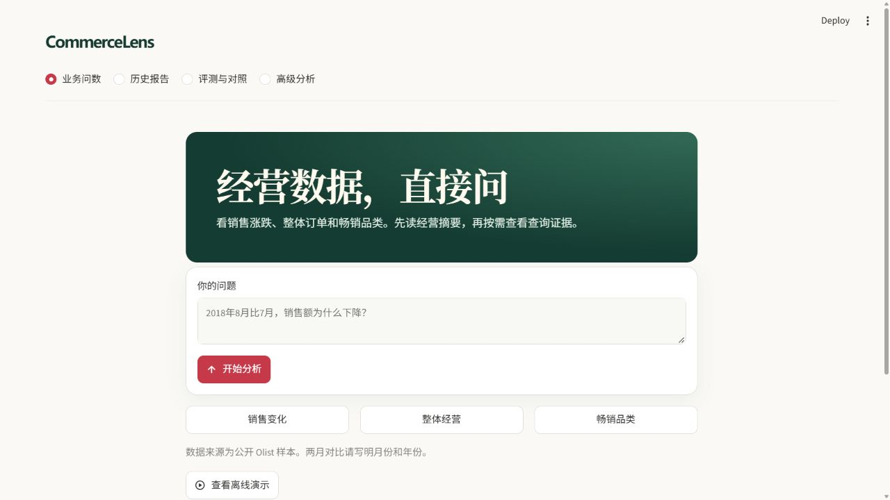
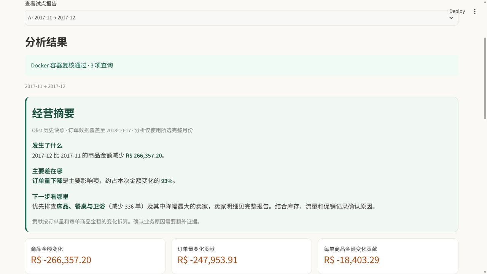
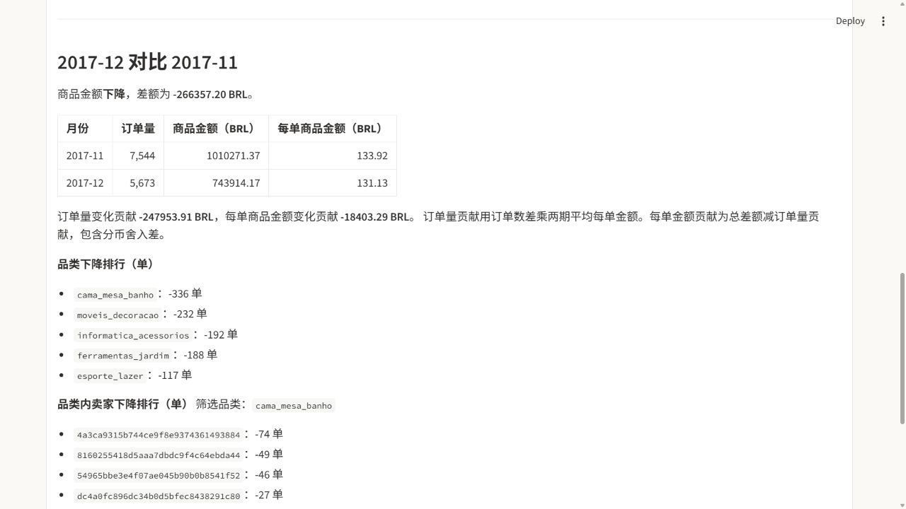
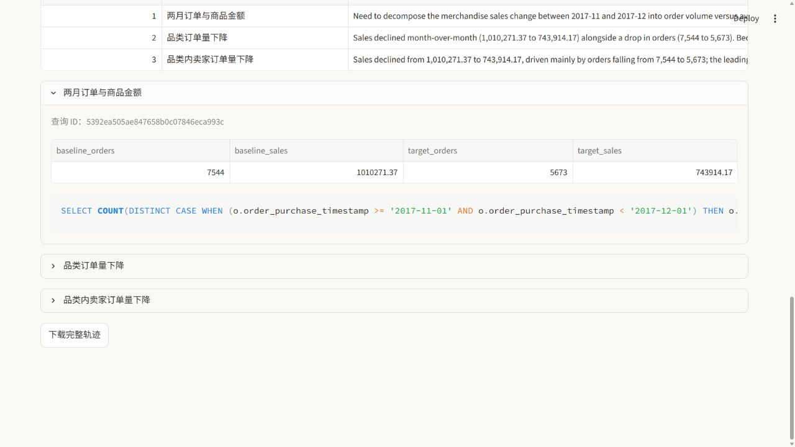
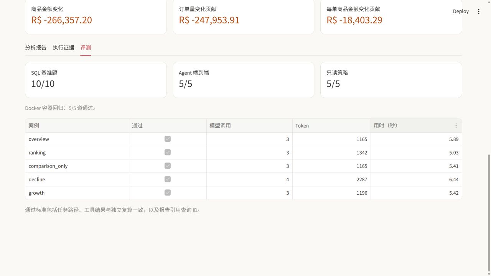
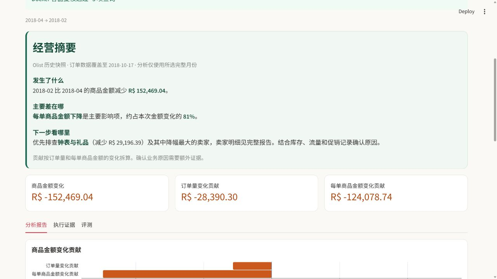
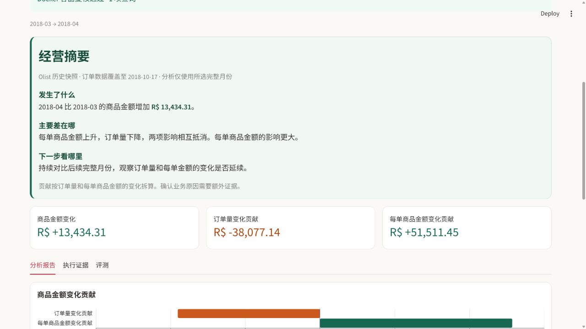
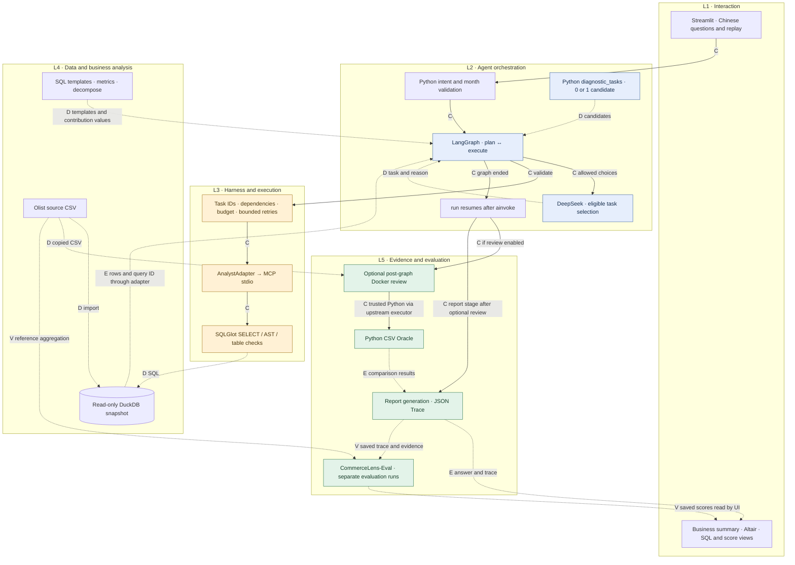

# CommerceLens — An Auditable E-commerce Data Analysis Agent

[English](README.md) · [简体中文](README.zh-CN.md)

## Project overview

CommerceLens is a single-Agent e-commerce analytics demo over public Olist data. It organizes part of an operator's investigation into monthly merchandise changes: compare metrics, decompose contributions, inspect declining categories and sellers, and assemble an evidence-linked report. Supported Chinese questions enter a controlled workflow whose query results and task paths can be inspected.

### Why an Agent?

A single known query can be answered with SQL or a BI dashboard. CommerceLens explores a longer investigation: collect evidence, select a permitted next task, stop under explicit conditions, and produce an inspectable report. LangGraph makes that loop explicit; the LLM provides bounded task selection in normal mode and report wording. In diagnostic mode, business rules determine the branch. The current implementation does not demonstrate that an LLM is necessary for that deterministic branch.

## Demo preview

Historical case A compares December with November 2017. Merchandise decreases by BRL 266,357.20; order-volume contribution is −BRL 247,953.91, approximately 93% of the difference. The diagnostic then queries declining categories and sellers.

Metrics use purchase time and all recorded statuses. Merchandise excludes freight. Contributions explain arithmetic changes; inventory or advertising causes require additional data.


| Case | Months | Merchandise change | Diagnostic path |
|---|---|---:|---|
| A | 2017-11 → 2017-12 | −BRL 266,357.20 | Monthly → category orders → seller orders |
| B | 2018-04 → 2018-02 | −BRL 152,469.04 | Monthly → category merchandise → seller merchandise |
| C | 2018-03 → 2018-04 | +BRL 13,434.31 | Monthly only; rule stops decline drill-down |





<details><summary>Diagnostic drill-down, SQL and evaluation</summary>








</details>

Screenshots capture the current main baseline running locally, replaying historical records with the page's Light theme selected. They do not represent new live inference.

## Key features

Three supported Chinese question families, month comparisons, contribution decomposition, bounded category/seller drill-down, SQL evidence, JSON execution traces and independent evaluation.

## System architecture

Five logical layers cover interaction, orchestration, execution governance, data/business rules, and evidence/evaluation. The complete layered diagram and exact execution flow are in the architecture guide.

[Layered architecture and control/data flows](docs/architecture.md)



## Core Engineering Contributions

1. **Controlled orchestration** — LangGraph maintains the loop. Normal-mode model choices are bounded by task, dependency and budget checks.
2. **Rule-guided e-commerce diagnostics** — Python contributions determine category/seller investigation. Diagnostic rounds expose at most one task.
3. **Evidence-based evaluation** — CSV references verify aggregates while separate checks examine paths, citations, policy and failures.

## Technology Stack

| Layer | Technology | Actual responsibility | Why it is used here |
|---|---|---|---|
| Runtime | Python 3.11 | Business rules, adapters and evaluation | One runtime for orchestration and independent reference code |
| Interaction | Streamlit + Altair | Chinese question UI, charts and replay | Local demonstration with inspectable evidence |
| Orchestration | LangGraph | Two-node plan/execute state loop | Explicit routing and termination |
| Model | DeepSeek API | Eligible task selection and normal report text | Bounded natural-language planning and expression |
| Tool boundary | AnalystAdapter + MCP stdio | Structured evidence, retries and local process calls | Keep tool execution behind a validated interface |
| Query | SQLGlot + DuckDB | AST constraints and read-only snapshot aggregation | Limit query surface while using local analytical SQL |
| Review | Docker + DeepAnalyze executor | Post-graph execution of trusted verification code | Reuse an existing isolated Python executor |
| Verification | CSV Oracle + CommerceLens-Eval | Independent aggregation, path/citation/policy/fault checks | Check both answers and execution behavior |

## Agent Workflow

Chinese routing validates intent and months before the graph. Its only nodes are plan and execute. Normal mode permits eligible task choice or finish after evidence. Diagnostic_tasks determines zero or one eligible task and termination in Python. SQL uses templates and saved definitions.

After graph completion, run optionally performs Docker review, handles reports and persists JSON. Diagnosis Markdown is always Python-rendered; normal reports are model-written. This is single-Agent orchestration using DeepAnalyze's execution modules.

## Harness-style Execution Governance

Project-written checks enforce task catalogs, dependencies, a four-task budget, invalid-choice correction, bounded query retries, AST restrictions, read-only execution, result validation and evidence recording. The main adapter calls MCP's SQL query tool.

[Mechanisms and source anchors](docs/technical_design.md)

## Evaluation Framework

| Suite | Historical result | Scope |
|---|---:|---|
| Golden SQL | 10/10 | CSV reference equality |
| Agent | 5/5 | Task path, numbers, query IDs |
| Docker Agent | 5/5 | Additional stored review checks |
| SQL Policy | 5/5 | Rejection and unchanged DB hash |
| Fault/report | 11/11 | Mock failures and fact fields |

These are historical results. This revision validates replay only. Overview initially ran three queries and later ran one, changing the fixed suite from 4/5 to 5/5; saved records cannot control all experimental variables. CSV aggregation is independent, while decomposition reuses the same function. Query-ID presence does not establish sentence-level entailment.

The release records separately document fresh Windows 10 / Python 3.11.9 / Streamlit 1.67.0 installation, three AppTest cases and real HTTP 200, without API, Docker, raw CSV or database.

[Scoring definitions, evidence and reproduction](docs/evaluation.md) · [Saved fresh-install record](docs/fresh_replay_validation.json)

## Quick Start — Offline Demo

No API key, Docker or raw CSV is required. Run from the repository root, then click 查看离线演示 to switch A/B/C.

```powershell
py -3.11 -m venv .venv
.venv/Scripts/python.exe -m pip install -r requirements-replay.txt
powershell -NoProfile -ExecutionPolicy Bypass -File scripts/start_demo.ps1
```

[http://127.0.0.1:8501/](http://127.0.0.1:8501/)

This package restores the Light theme configuration omitted in the earlier web upload. Keep the server process running.

## Optional Live Mode

Live execution requires full dependencies, raw CSV, DeepSeek configuration and Docker, and may incur API costs. Prepare source files using data/README.md.

```powershell
.venv/Scripts/python.exe -m pip install -r requirements-demo.txt
.venv/Scripts/python.exe scripts/build_phase1_data.py
docker pull python:3.11-slim
```

This package restores .env.example. Copy it to a local .env and set the configuration keys below, or point COMMERCE_LLM_CONFIG to an existing file. Never upload the populated .env.

```dotenv
LLM_BASE_URL=https://api.deepseek.com
LLM_MODEL_ID=your_model_id
LLM_API_KEY=your_private_key
```

Live API/Docker execution and full live installation were not validated in this documentation revision.

## Project Structure

| Directory | Responsibility |
|---|---|
| scripts/ | UI, routing, planner, adapters, SQL and review |
| commercelens_eval/ | Oracle and evaluation entry points |
| artifacts/ | Selected historical aggregate/trace/score fixtures |
| vendor/DeepAnalyze/ | Pinned upstream execution modules and license |
| docs/ | Architecture, design, evaluation and source appendix |

[Directory guide](docs/project_structure.md) · [Implementation appendix](docs/implementation_map.md)

## Limitations & Future Work

Question coverage is bounded by regex and task catalogs. Historical snapshots, incremental ingestion, queues, access control, persistent graph recovery and cross-dataset validation remain future work. OpenJudge, a general Grader Adapter, sentence-level scoring and measured human BI productivity gains are absent. Fixed SQL baselines know their paths and use a different timing boundary.

## License & Acknowledgements

Project-owned source/docs are MIT, attributed to Yessyye. Vendor files retain upstream notices. Olist-derived fixtures follow separate CC BY-NC-SA 4.0 terms and retain linkable seller IDs; see the data notice for commercial restrictions.

[LICENSE](LICENSE) · [DATA_LICENSE](DATA_LICENSE.md) · [Third-party notices](THIRD_PARTY_NOTICES.md)

[Current documentation validation](docs/documentation_review.md) · [Machine-readable replay observations](docs/documentation_validation.json)
