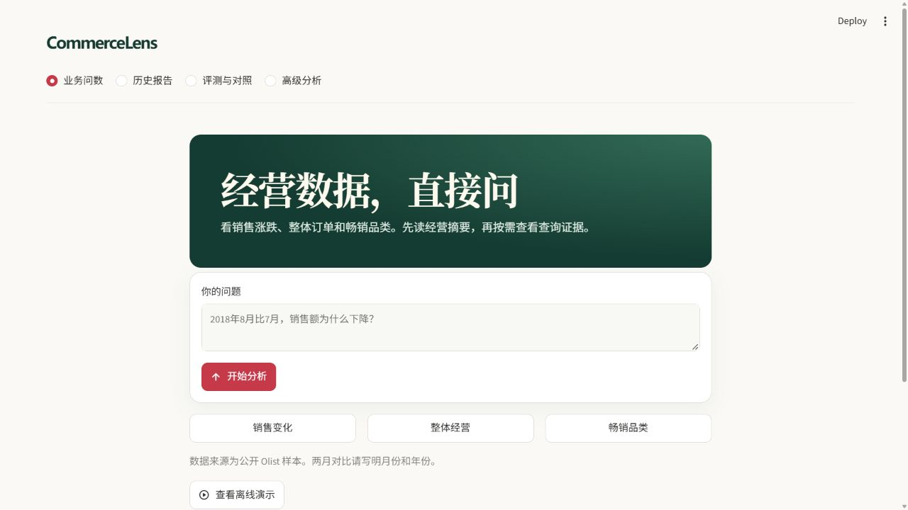
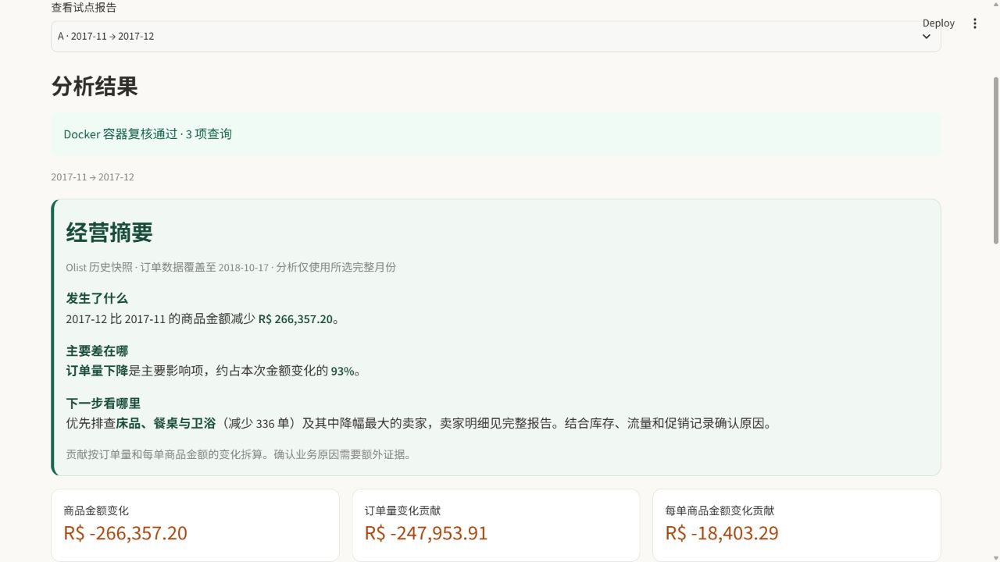
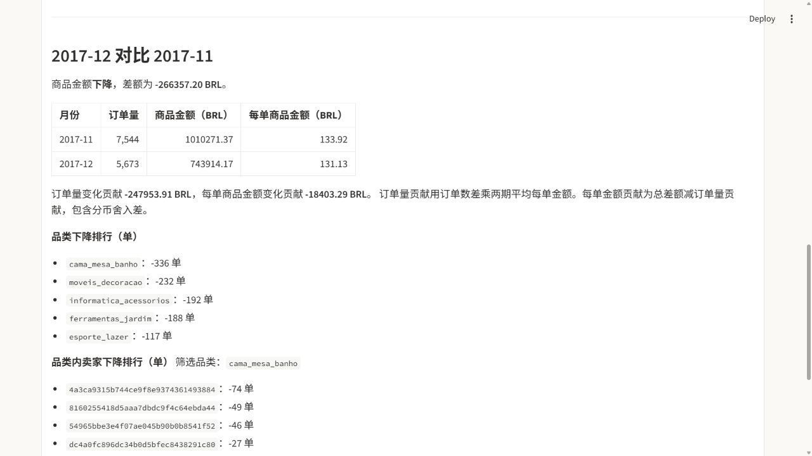
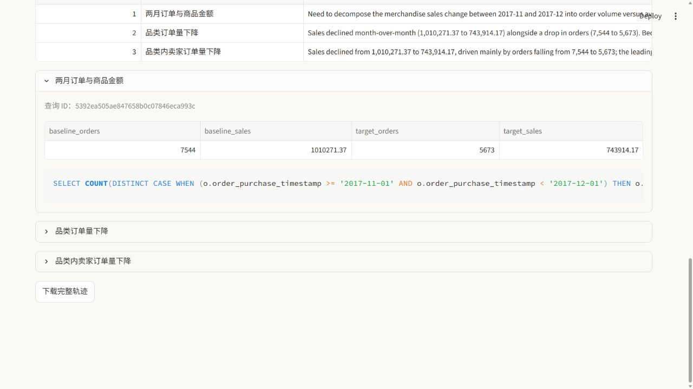
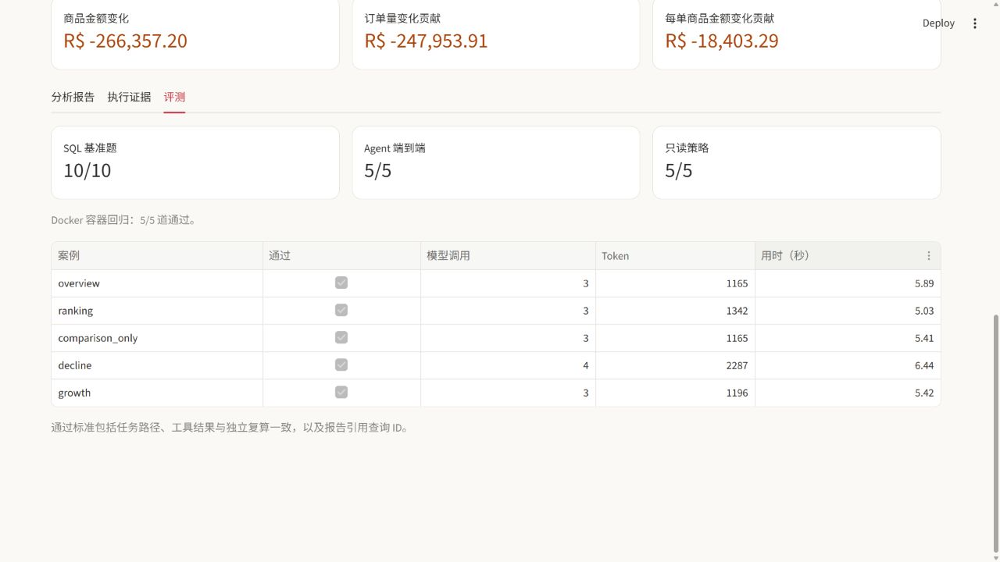
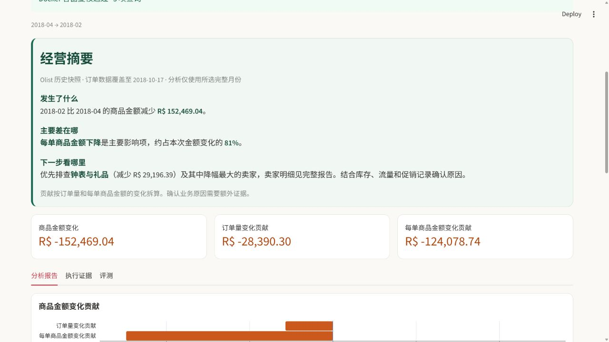
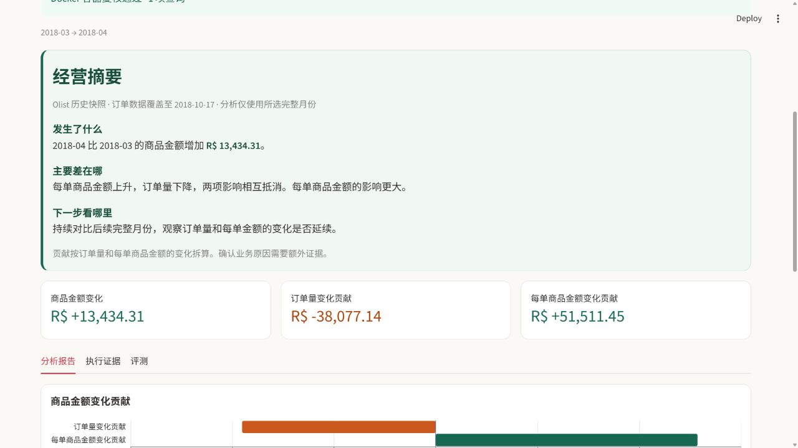
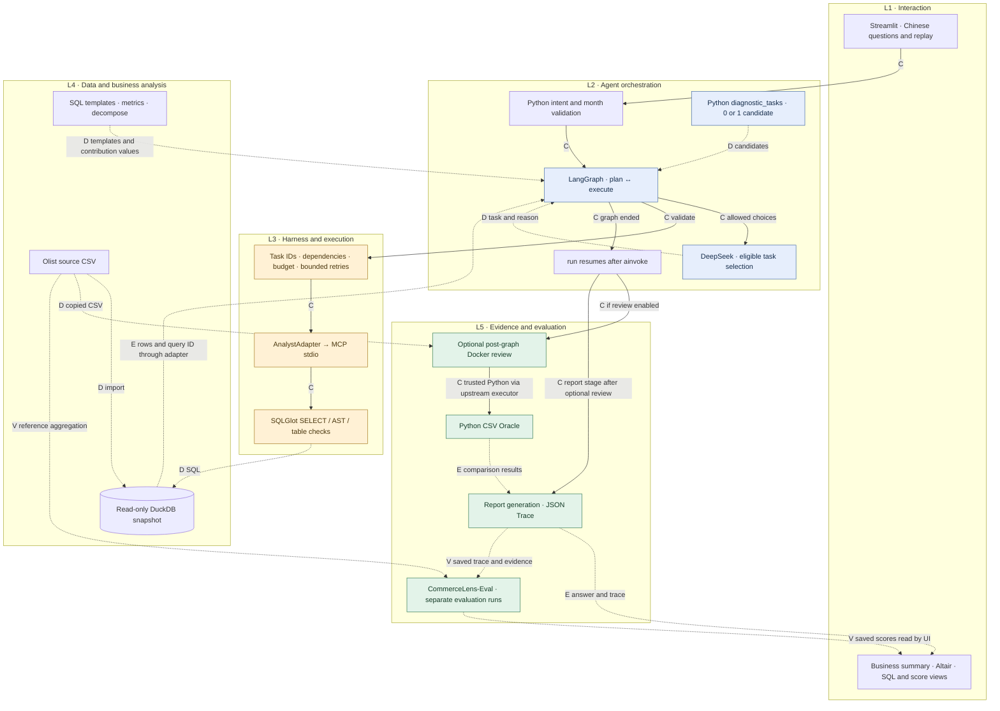

# CommerceLens — An Auditable E-commerce Data Analysis Agent

[English](README.md) · [简体中文](README.zh-CN.md)

## 项目与业务价值

一个具备受控自主分析、执行证据追踪与独立评测能力的电商数据分析 Agent。运营排查月度商品金额变化时，需要查两期指标、计算贡献、定位品类和卖家并整理报告。CommerceLens 将这些步骤组织为有限范围的中文问数工作流，结论可以追溯到实际查询。

### 为什么引入 Agent？

单个已知指标用 SQL 或 BI 看板即可解决。项目关注的是多步排查过程：获取证据、选择允许的下一项任务、满足条件后停止，并形成可以复核的报告。LangGraph 显式管理循环，LLM 在普通模式承担受限任务选择和报告表达。诊断模式的业务分支由规则决定；目前不能据此证明该固定分支必须使用大模型。

## 真实演示

历史案例 A：2017 年 12 月比 11 月商品金额减少 R$ 266,357.20，订单量变化贡献 −R$ 247,953.91，约占差额 93%。之后按订单量查下降品类和卖家。

按下单时间统计全部订单状态，商品金额不含运费。贡献表示数学构成，库存或广告等因果原因需要额外数据。


| 案例 | 基准月 → 目标月 | 商品金额变化 | 诊断路径 |
|---|---|---:|---|
| A | 2017-11 → 2017-12 | −BRL 266,357.20 | 月度贡献 → 品类订单量 → 卖家订单量 |
| B | 2018-04 → 2018-02 | −BRL 152,469.04 | 月度贡献 → 品类商品金额 → 卖家商品金额 |
| C | 2018-03 → 2018-04 | +BRL 13,434.31 | 只查月度贡献；规则停止下降下钻 |





<details><summary>展开三个案例、诊断下钻、SQL 与评测截图</summary>








</details>

截图来自本轮实际运行的远程 main 版本，回放历史记录，使用页面 Light 主题。截图没有重新执行模型推理。

## 核心功能

支持三类中文问题、月间指标比较、贡献拆解、品类卖家下钻、SQL 证据、执行轨迹及独立评测。

## 系统架构



五层分别负责交互、编排、执行治理、数据业务和证据评测。下图及精确执行图见架构文档。

[完整五层架构与控制流、数据流](docs/architecture.md)

## 三项核心工程设计

1. **受控自主分析编排** — LangGraph 管理循环。普通模式让模型在候选目录中选择，Python 校验依赖、任务和预算。
2. **规则驱动的电商诊断** — 比较订单量和每单金额的贡献，下钻到下降品类及其卖家。诊断模式每轮至多一个候选。
3. **结果与过程联合评测** — 数值由 CSV Oracle 核对，路径、引用、安全和故障分别评分。

## 技术栈与职责

| 分层 | 技术 | 实际职责 | 在本项目中的用途 |
|---|---|---|---|
| 运行基础 | Python 3.11 | 业务规则、适配层和评测 | 使用同一运行语言组织流程与参考计算 |
| 交互展示 | Streamlit + Altair | 中文问数、图表、历史回放 | 提供可本地运行、可展开证据的演示 |
| Agent 编排 | LangGraph | plan/execute 两节点循环 | 显式管理状态、路由和停止条件 |
| 模型调用 | DeepSeek API | 合法任务选择、普通报告表达 | 在受限范围内处理规划与自然语言表达 |
| 工具边界 | AnalystAdapter + MCP stdio | 结构化证据、重试、本地进程通信 | 通过有校验的接口调用查询工具 |
| 数据查询 | SQLGlot + DuckDB | AST 检查、只读快照聚合 | 约束查询能力并使用本地分析 SQL |
| 执行复核 | Docker + DeepAnalyze executor | 图外执行可信复核代码 | 复用已有隔离 Python 执行模块 |
| 独立验证 | CSV Oracle + CommerceLens-Eval | 独立聚合与路径、引用、安全、故障检查 | 同时检查结果和执行过程 |

## Agent 工作流与模型边界

中文路由先校验问题和月份。图内只有 plan 和 execute。普通模式允许模型选任务或在有证据后结束。诊断模式的 diagnostic_tasks 由 Python 决定零或一个候选及结束条件。SQL 使用模板和预存定义。

图执行结束后，run 可选调用 Docker Review，然后生成报告并保存 JSON。诊断 Markdown 始终由 Python 渲染，普通文字报告由模型生成。当前为单 Agent，复用的是 DeepAnalyze 容器执行模块。

## Harness 执行治理

本项目的自定义治理由现有函数实现，包括任务白名单、依赖、四任务预算、无效选择纠正、查询有限重试、AST 检查、只读执行、返回结构校验及证据记录。主 adapter 实际调用 MCP 的 SQL 查询工具。

[逐项机制与源码位置](docs/technical_design.md)

## 独立评测体系

| 评测项 | 历史成绩 | 检查范围 |
|---|---:|---|
| Golden SQL | 10/10 | CSV 参考值一致性 |
| Agent | 5/5 | 任务路径、数值、查询 ID |
| Docker Agent | 5/5 | 附加检查保存的容器复核结果 |
| SQL Policy | 5/5 | 拒绝非法查询、数据库哈希不变 |
| Fault/report | 11/11 | 模拟故障及报告事实字段 |

以上为历史记录。本轮只验证离线回放。初始 4/5 的总览多查两次，后轮路径由三次变为一次，固定五题为 5/5；现有记录不能控制所有实验变量。CSV 聚合独立实现，贡献函数在主流程和复核中复用。Query ID 出现检查不覆盖句子语义。

发布阶段已有全新 Windows 10 / Python 3.11.9 / Streamlit 1.67.0 环境安装记录，三案例 AppTest 与真实 HTTP 200 通过，未使用 API、Docker、原始 CSV 或数据库。

[评分定义、历史证据及复现命令](docs/evaluation.md) · [已保存的新环境记录](docs/fresh_replay_validation.json)

## 快速开始：离线 Demo

无需 API Key、Docker 或原始 CSV。在项目根目录执行以下命令，点击“查看离线演示”切换 A/B/C。

```powershell
py -3.11 -m venv .venv
.venv/Scripts/python.exe -m pip install -r requirements-replay.txt
powershell -NoProfile -ExecutionPolicy Bypass -File scripts/start_demo.ps1
```

[http://127.0.0.1:8501/](http://127.0.0.1:8501/)

本包已恢复之前网页上传遗漏的浅色主题配置。服务进程必须保持运行。

## 可选：实时 API 与 Docker 模式

实时模式需要完整依赖、原始 CSV、DeepSeek 和 Docker，可能产生费用。原始数据准备见 data/README.md。

```powershell
.venv/Scripts/python.exe -m pip install -r requirements-demo.txt
.venv/Scripts/python.exe scripts/build_phase1_data.py
docker pull python:3.11-slim
```

本包已恢复 .env.example。将其复制为本地 .env 并填写以下配置，或用 COMMERCE_LLM_CONFIG 指向已有文件。不要上传填写后的 .env。

```dotenv
LLM_BASE_URL=https://api.deepseek.com
LLM_MODEL_ID=your_model_id
LLM_API_KEY=your_private_key
```

实时 API、Docker 实跑和完整实时环境安装在本轮未验证。

## 项目结构

| Directory | Responsibility |
|---|---|
| scripts/ | UI, routing, planner, adapters, SQL and review |
| commercelens_eval/ | Oracle and evaluation entry points |
| artifacts/ | Selected historical aggregate/trace/score fixtures |
| vendor/DeepAnalyze/ | Pinned upstream execution modules and license |
| docs/ | Architecture, design, evaluation and source appendix |

[目录说明](docs/project_structure.md) · [代码级附录](docs/implementation_map.md)

## 当前限制与后续方向

问题范围受正则和任务目录限制。数据为历史快照，增量同步、队列、权限、图状态恢复和跨数据集验证仍待实现。OpenJudge、通用 Grader Adapter、句子级语义评分及人工 BI 提效数据尚未具备。固定 SQL 对照预知路径，计时边界与 Agent 不同。

## 许可与致谢

自有代码与文档为 MIT，署名 Yessyye。第三方源码保留原始许可，Olist 派生示例为独立 CC BY-NC-SA 4.0 数据条款，含可关联源数据的 seller ID。商业限制见数据说明。

[LICENSE](LICENSE) · [DATA_LICENSE](DATA_LICENSE.md) · [Third-party notices](THIRD_PARTY_NOTICES.md)

[本轮文档核验记录](docs/documentation_review.md) · [离线回归实际结果](docs/documentation_validation.json)
