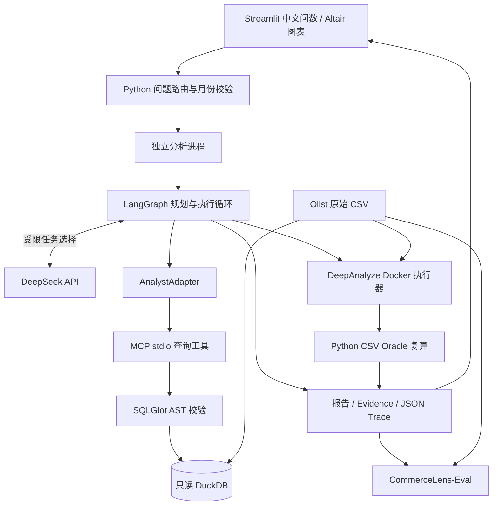

# CommerceLens

[English](README.md) · **简体中文**

面向电商经营分析的可审计数据分析 Agent，包含受控任务编排、执行治理和独立评测。

用户可以用中文查询 Olist 电商数据，查看商品金额变化、订单量和每单金额的贡献，以及品类和卖家下钻。页面先展示经营摘要与图表，再按需展开 SQL、查询结果和复核证据。

## 三分钟启动离线演示

**无需 API Key、Docker 或原始 CSV。** 仓库已经包含经过审查的历史分析轨迹。离线演示回放这些真实运行记录。

推荐环境为 Windows、Python 3.11。下载仓库 ZIP 并解压，或运行：

```powershell
git clone https://github.com/Yessyye/CommerceLens.git
cd CommerceLens
```

在包含 README.md 的项目根目录运行：

```powershell
py -3.11 -m venv .venv
.venv/Scripts/python.exe -m pip install -r requirements-replay.txt
powershell -NoProfile -ExecutionPolicy Bypass -File scripts/start_demo.ps1
```

打开 [本地页面](http://127.0.0.1:8501/)，点击 **查看离线演示**。

1. 选案例 **A**，查看商品金额减少、主要驱动和下一步排查方向。
2. 打开 **执行证据**，查看两期指标、品类与卖家下钻的 SQL 和返回结果。
3. 打开 **评测**，查看黄金 SQL、Agent 回归和只读策略的历史评分。
4. 切换案例 **C**，查看订单量下降、每单金额上升，最终商品金额上涨的情况。

启动脚本需要保持运行。本机服务停止后，浏览器地址会暂时无法访问，重新执行启动命令即可。

## 一个完整分析案例

问题为 **2017 年 12 月比 11 月，销售额变化了多少？**

历史案例 A 的商品金额减少 **R$ 266,357.20**。订单量变化贡献为 **−R$ 247,953.91**，约占差额的 **93%**。系统按订单量查下降品类，再查降幅最大品类中的卖家。页面提供经营摘要、贡献图及三条查询的复核记录。

贡献拆解用于定位差额集中在哪里。库存、流量、广告或促销是否导致变化，需要相应业务数据验证。数据按下单时间统计全部记录状态，商品金额按明细价格求和，不含运费。

## 三个工程设计亮点

| 设计 | 实际实现 |
|---|---|
| 受控自主分析编排 | LangGraph 管理状态和执行循环，模型在候选任务中选择，Python 校验任务、依赖和预算 |
| 电商领域业务适配 | 定义 Olist 指标粒度、月间对比、贡献拆解和品类/卖家分析 |
| 结果与过程联合评测 | 将独立 CSV 参考结果、SQL 核验、Docker 复核和任务轨迹评分关联起来 |

## 架构与技术栈



| 组件 | 用途 |
|---|---|
| Python、Streamlit、Altair | 问题输入、摘要、图表与回放 |
| LangGraph、DeepSeek | 状态流转、受限任务选择与模型调用 |
| MCP stdio、AnalystAdapter | 本地工具通信、证据结构校验与受限重试 |
| SQLGlot、DuckDB | SQL 解析与只读分析查询 |
| Docker、DeepAnalyze 执行器 | 隔离运行可信的复核脚本 |
| CommerceLens-Eval | 数值、路径、引用、安全与故障检查 |

## Agent 的行为边界

当前是**单 Agent** 架构。中文入口通过规则识别两月比较、全量经营总览和畅销品类。

普通分析模式中，模型从当前允许的任务中选择下一步，已有证据后可以选择结束。诊断模式每轮最多只有一个候选任务，Python 根据金额涨跌和贡献决定下钻分支、品类筛选及结束条件。

SQL 来自受控模板或预存定义。诊断报告始终由 Python 渲染，普通分析报告由模型生成。页面复用 DeepAnalyze 的上游容器执行模块，其完整 General Agent 分析循环不在页面主链路中。

## Harness 执行治理与独立复算

执行边界包含任务 ID、依赖、查询预算、重试次数、SQL AST、数据表和返回结构校验。DuckDB 使用只读连接，关闭外部访问，配置查询中断定时器和资源限制。

Docker 复核运行本项目准备的可信 Python 脚本，明确设置断网，并保留查询关联的复核结果。公开轨迹中的容器和镜像标识已脱敏。

CSV Oracle 直接遍历原始 CSV，用字典、集合和 Decimal 另行聚合。贡献拆解函数在主流程和容器中复用，因此独立聚合与公式复用的边界需要区分。数值比较采用规范化后的精确相等。

## 评测结果与验证环境

以下是随项目保存的**历史评测结果**。

| 评测 | 历史结果 | 检查内容 |
|---|---:|---|
| Golden SQL | 10/10 | SQL 与独立 CSV 参考结果 |
| Agent 端到端 | 5/5 | 预期任务路径、数值、查询 ID 引用 |
| Docker Agent | 5/5 | 上述检查及保存的容器复核证据 |
| SQL 只读策略 | 5/5 | 非法请求拒绝、数据库哈希不变 |
| 故障及报告字段 | 11/11 | 注入超时、无效计划、空数据和错误报告字段 |

初轮 Agent 评测为 4/5。经营总览误受默认月份影响，执行了三次查询。修正约束后，同一套题的总览路径回到一次查询，整批为 5/5。这是固定小样本回归结果。

发布前另外创建了全新 Python 3.11.9 环境，从官方 PyPI 安装离线依赖。Windows 10、Streamlit 1.67.0 下，三个案例、SQL 证据和评测展示均通过 AppTest，真实 Streamlit 服务健康检查正常，首页返回 HTTP 200。详见 [验证记录](docs/fresh_replay_validation.json)。

实时 API、Docker 实跑、完整实时环境安装及跨平台兼容性尚未在本轮验证。当前页面截图待补充。引用 ID 出现检查没有覆盖报告逐句语义，OpenJudge 尚未接入。

## 可选的实时分析

实时问数需要自行配置 DeepSeek、运行 Docker，并准备原始数据。可能产生 API 费用。

1. 按 [数据准备说明](data/README.md) 下载九个 Olist CSV，放入 data/raw/olist/。
2. 安装完整依赖并构建本地快照。
3. 从示例复制配置，填写自己的模型 ID 和密钥。
4. 启动 Docker Desktop 的 Linux 容器后拉取复核镜像。

```powershell
.venv/Scripts/python.exe -m pip install -r requirements-demo.txt
.venv/Scripts/python.exe scripts/build_phase1_data.py
Copy-Item .env.example .env
docker pull python:3.11-slim
```

| 配置项 | 作用 |
|---|---|
| LLM_BASE_URL | DeepSeek 官方 API 端点 |
| LLM_MODEL_ID | 账号可用的模型 ID |
| LLM_API_KEY | 私人 API Key，保存在本地 |

也可通过 COMMERCE_LLM_CONFIG 指向已有配置文件。已有 DuckDB 会被快照构建脚本复用，数据增量更新仍待实现。

## 项目导航

- [实际目录结构](docs/project_structure.md)
- [架构说明](docs/architecture.md)
- [技术设计与边界](docs/technical_design.md)
- [代码级实现地图](docs/implementation_map.md)
- [评测方法与复现命令](docs/evaluation.md)
- [发布审计](GITHUB_RELEASE_AUDIT.md)
- [派生数据逐文件清单](docs/derived_data_inventory.md)

## 数据、许可证与后续工作

自有代码与文档采用 MIT，公开版权署名为 Yessyye。复制的上游执行模块保留原始许可。Olist 派生示例遵循独立的 CC BY-NC-SA 4.0 数据说明，包含可关联源数据的 seller ID，商业使用限制应单独核对。

原始 CSV、密钥、DuckDB、缓存及虚拟环境均不随仓库发布。当前尚未实现持续数据同步、多租户权限、后台任务队列或人工 BI 提效验证。

[代码许可](LICENSE) · [数据许可](DATA_LICENSE.md) · [第三方声明](THIRD_PARTY_NOTICES.md)
