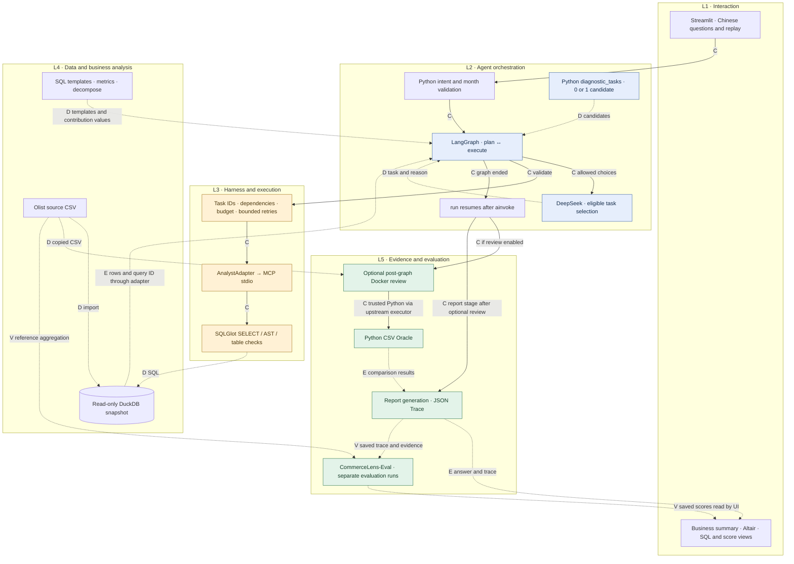
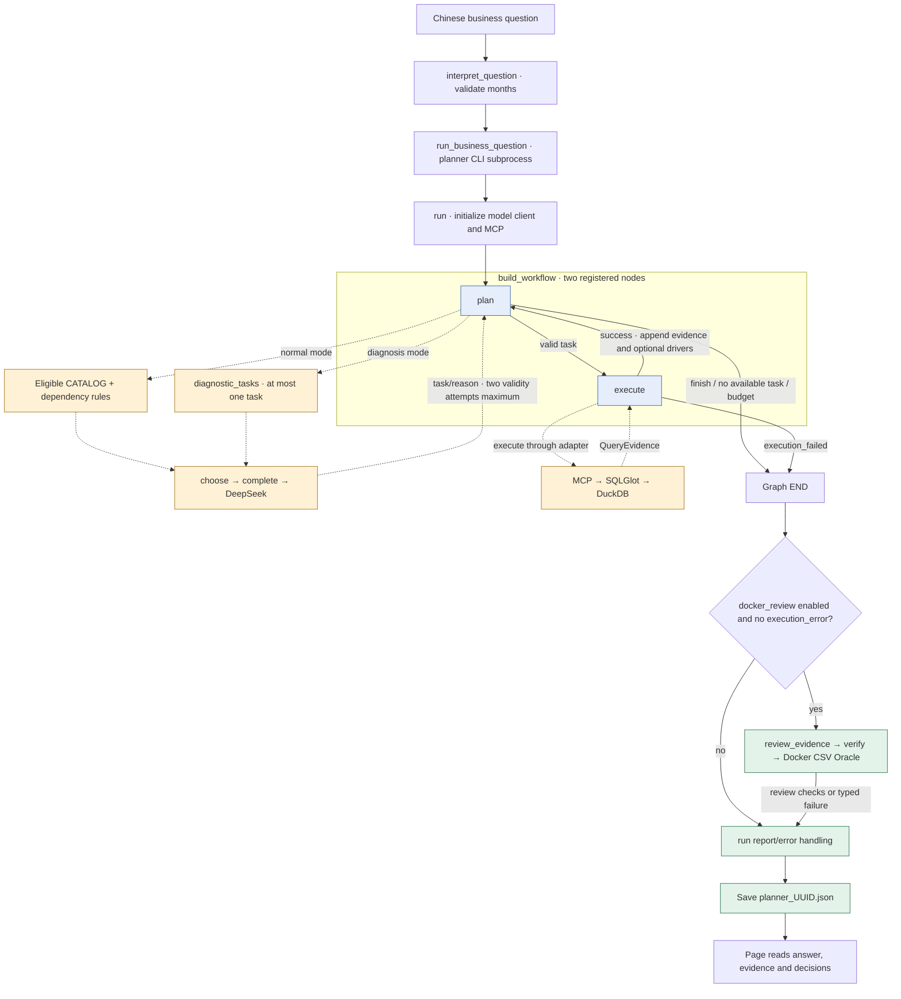

# Architecture

[English overview](../README.md) · [中文项目介绍](../README.zh-CN.md) · [Technical design](technical_design.md) · [Evaluation](evaluation.md)

This document maps the runtime at source baseline `d60bbb4074199b71f5c2a272680c235f9a13e974`. Layers describe responsibilities within a local application. The only registered LangGraph nodes are `plan` and `execute`.

## Five logical layers

| Layer | Responsibility | Code anchors |
|---|---|---|
| L1 Interaction | Chinese questions, historical replay, summaries, contribution charts, SQL and score views | `demo_app.main/show_questions/show_trace/show_pilot`, Altair |
| L2 Agent orchestration | Intent/month routing, state, eligible tasks, model selection, loop and termination | `business_questions.interpret_question`, `Comparison.validate`, `phase2_planner.build_workflow/run` |
| L3 Harness and execution | Task validation, dependencies, budget, retry, tool result structure and SQL policy | `build_workflow.plan`, `McpAnalystAdapter.execute`, `execute_readonly_sql` |
| L4 Data and business analysis | Olist snapshot, metric SQL, month comparisons, contribution calculation and bounded category/seller ranking | `Comparison`, `sales_drivers.decompose`, `build_phase1_data.main` |
| L5 Evidence and evaluation | Evidence/trace persistence, optional graph-external review, independent CSV aggregation and separate evaluation runs | `run`, `review_evidence`, `docker_review.verify`, `baseline.oracle`, `commercelens_eval` |

Custom Harness-style governance spans planning and tool execution. Its checks are distributed across the existing functions. L4 contains domain metric definitions and diagnostic rules.

## Layered system diagram

Solid arrows marked C carry execution control. Dotted arrows marked D carry data, E carry evidence and V carry evaluation inputs. Colors emphasize project orchestration, governance and verification.

The D arrow from domain rules summarizes local computations used during query construction and `execute`. The evidence-return arrow abstracts the reverse route through DuckDB, MCP and the adapter. CommerceLens-Eval consumes stored runs or launches its own evaluation jobs. The page reads saved scores, so opening a result does not run the benchmark suites.

## Exact Agent execution flow

The functions drawn outside LG are code called from nodes or from `run`. They are not extra registered graph nodes. Unhandled client, initialization or file errors can still escape before trace persistence.

## Normal planning and diagnostic planning

| Behavior | Normal mode | Diagnostic mode |
|---|---|---|
| Eligible tasks | Unexecuted CATALOG entries with satisfied dependencies | `diagnostic_tasks(observed, drivers)` |
| First task | Model can select overview, ranking or month difference | Only monthly_drivers |
| Subsequent branch | Model chooses among eligible tasks or finish | Python selects the category metric, then a seller task |
| Finish | Model may choose finish after evidence exists | Python finishes when candidate list becomes empty |
| Final answer | Model-written Chinese text, prompted to cite query IDs | `render_report` always renders trusted facts |

The diagnostic rule compares the two signed contributions after confirming total decline. A more negative order-volume contribution selects order-count breakdown. Otherwise it selects merchandise-value breakdown. A tie takes the merchandise-value branch. Seller queries use the first declining category, provided it is non-null.

## Entry-point and process boundaries

| UI entry | Runtime behavior | Requirements |
|---|---|---|
| 业务问数 | `show_questions → run_business_question` starts planner CLI with a 300-second parent timeout and Docker review enabled | Data snapshot, API configuration, Docker |
| 高级分析 | `main` directly calls `asyncio.run(run(...))`; review checkbox is configurable | Data/API, plus Docker when selected |
| 历史报告 | Reads existing `planner_*.json` | Replay dependencies and shipped fixtures |
| 评测与对照 / 查看离线演示 | Reads pilot/score JSON and associated traces | Replay dependencies and shipped fixtures |

MCP itself runs another local Python process over stdio, initialized by `run`. Each database query opens a read-only DuckDB connection. Docker review runs after graph completion through a separate review subprocess. See [the function-level appendix](implementation_map.md) for signatures and persisted fields.

## Evidence and independent evaluation

Query IDs tie tool results to reports and container comparison checks. They are random identifiers. The CSV Oracle uses a separate Python aggregation implementation, while contribution decomposition reuses `decompose` and receives the SQL-produced monthly row inside Docker.

The independent evaluation path is `CSV references + queries/saved traces → CommerceLens-Eval → numeric/path/citation/policy/fault results`. It is outside the mandatory request path. See [evaluation.md](evaluation.md) for the exact predicates and historical evidence.
